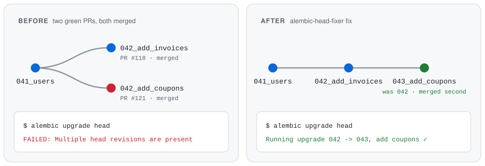

<h1 align="center">alembic-head-fixer</h1>

<p align="center">
  <b>Two PRs. Two migrations. One broken deploy.</b><br>
  Catch parallel Alembic migrations before they break <code>alembic upgrade head</code> —<br>
  and safely re-chain the ones that slip through, without touching anything your database already ran.
</p>

<p align="center">
  <a href="https://github.com/Nishchalpr4/alembic-head-fixer/actions/workflows/ci.yml"></a>
  <a href="https://github.com/Nishchalpr4/alembic-head-fixer/releases"></a>
  
  
  <a href="LICENSE"></a>
</p>

<p align="center">
  <a href="#quickstart"><b>Quickstart</b></a> ·
  <a href="#how-it-works"><b>How it works</b></a> ·
  <a href="#why-not-alembic-merge-heads"><b>vs. <code>alembic merge</code></b></a> ·
  <a href="#faq"><b>FAQ</b></a>
</p>

<p align="center">
  <picture>
    <source media="(prefers-color-scheme: dark)" srcset="assets/hero-dark.svg">
    <source media="(prefers-color-scheme: light)" srcset="assets/hero-light.svg">
    
  </picture>
</p>

- 🛡️ **Never moves what already ran.** A git tag records what your database has run; those files are never touched.
- 🔍 **Catches it in the PR.** Forks, duplicate ids, stale branch points and ids too long for `alembic_version` fail CI before merge.
- 🔧 **Repairs it in the deploy.** Two green PRs that still collide are re-chained in merge order, and the PR author gets a comment.
- ⚛️ **All or nothing.** The whole fix is planned and validated before a single file is written.
- 🪶 **Zero dependencies, zero imports.** Revision files are read with `ast` — no app settings, no `env.py`, no database.
- 🧩 **Fits where you are.** GitHub Action, pre-commit hook or plain CLI. Works with Flask-Migrate layouts too.

---

## Why this happens

Every Alembic migration names its parent in `down_revision`. Two developers branch off the same head and each adds a migration on top of `041`. Each PR passes CI on its own. Once both merge, the history forks, Alembic refuses to guess which one runs first, and every deploy fails until someone fixes it by hand.

## The usual hand fix is the dangerous one

The usual fix is to edit `down_revision`s until there is one head again. That's fine — **unless one of those migrations already ran.**

Alembic remembers exactly one thing about your database: the current revision id. It only ever walks *forward* from there. Re-point an already-applied migration so it sits after a newcomer, and the newcomer ends up *behind* the database's position. Alembic will never run it. No error, no warning. You find out when a column is missing in production.

`alembic-head-fixer` is built around one rule: **what already ran never moves.**

## How it works

| Command | When | What it does |
|---|---|---|
| `check` | every PR | Fails if the history isn't a single head, ids clash, a parent doesn't exist, or an id won't fit in `alembic_version` (32 chars). With `--base-ref`, also fails if your migration starts from a head that's no longer current. |
| `fix` | deploy, **before** migrating | If the history forked: keeps every migration the database already ran exactly as it is, and replays the rest onto the head in the order their PRs merged. |
| `mark-applied` | deploy, **after** migrating | Moves a git tag to the commit you just migrated. That tag is how `fix` knows what has run. |

The fix is committed back to the branch, and the PR whose migration moved gets a comment saying exactly what changed. If the only way to get one head is to rewrite a migration that already ran, `fix` writes nothing and fails the deploy. That needs a human.

## Quickstart

### GitHub Actions

**On every PR** — stop the fork before it merges:

```yaml
- uses: actions/checkout@v4
  with:
    fetch-depth: 0
- uses: Nishchalpr4/alembic-head-fixer@v1
  with:
    command: check
    base-ref: origin/${{ github.base_ref }}
```

**In your deploy** — repair the race two green PRs can still create:

```yaml
- uses: actions/checkout@v4
  with:
    fetch-depth: 0              # merge order comes from history

- uses: Nishchalpr4/alembic-head-fixer@v1
  with:
    command: fix                # before anything touches the database

- run: alembic upgrade head     # your migrate step

- uses: Nishchalpr4/alembic-head-fixer@v1
  with:
    command: mark-applied       # only after the migration succeeded
```

The deploy job needs `contents: write` (and `pull-requests: write` for comments), and should run one at a time per branch (`concurrency:`). Complete workflows: [`examples/pr-check.yml`](examples/pr-check.yml), [`examples/deploy.yml`](examples/deploy.yml).

### pre-commit

```yaml
# .pre-commit-config.yaml
repos:
  - repo: https://github.com/Nishchalpr4/alembic-head-fixer
    rev: v1.0.0
    hooks:
      - id: alembic-head-fixer
```

Runs `check` whenever a revision file or `alembic.ini` changes.

### CLI

```bash
pip install git+https://github.com/Nishchalpr4/alembic-head-fixer

alembic-head-fixer check                                         # single head?
alembic-head-fixer check --base-ref origin/main                  # ...and does my branch start at main's head?
alembic-head-fixer fix --applied-ref alembic-applied --dry-run   # what would move?
```

```text
$ alembic-head-fixer fix --applied-ref alembic-applied
Migration history is not deployable:
  - duplicate revision id '042' in 042_add_coupons.py and 042_add_invoices.py
Re-chained onto the applied history (alembic-applied untouched):
  042_add_coupons.py: revision '042' -> '043', down_revision '041' -> '042', renamed to 043_add_coupons.py
Single head is now '043'.
```

It finds your revision files through `alembic.ini` (`script_location` or `version_locations`), falling back to `alembic/versions` and Flask-Migrate's `migrations/versions`. Point it elsewhere with `--config` or `--versions-dir`.

Exit codes: `0` fine or fixed · `1` problem found, or no safe fix · `2` configuration or git error.

## Exactly what "re-chain" does

Migrations that haven't run are replayed onto the applied head in the order they landed on the branch. It reads first-parent history, so a PR counts from when it *merged*, not when its commits were written.

Each one that already attaches to the current head with a unique id is left untouched. Each one that doesn't:

- gets `down_revision` pointed at the current head;
- if its id is a number (`042`, `0042`, `1203`) that's taken or would sort before the head, gets the next free number, keeping the zero-padding, with the filename prefix and the `Revision ID:` / `Revises:` docstring lines updated to match;
- if its id is anything else (`alice_01`, `3f2a9c1b7d4e`), keeps it — or becomes `alice_01_2` if that id is taken.

A stack of several migrations from one PR moves together, in order.

## Why not `alembic merge heads`?

Fair question. Merge revisions are Alembic's built-in answer, and they work. The differences:

- **A merge is manual and after the fact.** By the time someone runs it, the deploy has already failed.
- **A merge keeps the history a graph.** `fix` keeps it a straight line, which is easier to read, review and downgrade through.
- **A merge doesn't decide order.** With two parents, which one runs first on a fresh database is up to Alembic. A line makes it explicit.

If your team prefers merge revisions, use `check` on PRs and skip `fix`. `check` is happy with merge revisions.

## Reference

### `check`

| Option | |
|---|---|
| `--base-ref REF` | Branch this will merge into (e.g. `origin/main`). New migrations must grow from its current head. |
| `--max-id-length N` | Longest allowed revision id. Default `32`, the size of `alembic_version.version_num`. |
| `-c, --config PATH` | `alembic.ini` to read. Default `./alembic.ini`. |
| `--versions-dir PATH` | Revision files directory. Overrides `--config`. |

### `fix`

| Option | |
|---|---|
| `--applied-ref REF` | **Required.** Git ref of the last commit whose migrations ran on the database. Nothing in it is ever moved. |
| `--dry-run` | Print the plan; write nothing. |
| `--report PATH` | Write a JSON list of what moved (with the commit that added each file). |
| `-c, --config`, `--versions-dir` | As for `check`. |

### Action inputs

| Input | Default | |
|---|---|---|
| `command` | — | `check`, `fix` or `mark-applied`. |
| `applied-tag` | `alembic-applied` | Tag recording the last migrated commit. |
| `base-ref` | | `check`: branch the PR merges into. |
| `config`, `versions-dir` | | As for the CLI. |
| `working-directory` | `.` | For monorepos: run inside a service folder. |
| `push` | `true` | `fix`: push the fix commit to the branch. |
| `comment` | `true` | `fix`: comment on and label (`migration-rechained`) the PRs whose migrations moved. |
| `github-token` | `github.token` | Used to push and comment. |

Outputs: `changed` (`true` when `fix` moved something) and `sha` (the commit to build and migrate from).

## FAQ

### My local database ran the old revision id

Your machine ran `042_add_coupons` as `042`. After the fix, `042` is invoices and coupons is `043`. The easiest way out is to recreate your dev database. By hand:

```bash
alembic stamp 041      # back to before both
alembic upgrade 042    # run invoices, which you don't have yet
alembic stamp 043      # coupons already ran, under its old id
```

### The tag doesn't exist yet

On the first deploy, the action only checks. `mark-applied` creates the tag once that first migration succeeds. On the CLI, create it yourself at the last commit you migrated: `git tag alembic-applied <sha> && git push origin alembic-applied`.

### We promote to production from a different branch

Run `fix` on the branch where PRs merge. When you carry changes onward (cherry-pick, release branch), take the fix commit with them. The PR comment links to it.

### Does it work with hash revision ids?

Yes. Only all-digit ids of up to 6 characters are treated as numbers and renumbered. Every other id keeps its value.

### Monorepos, several services

Run once per service with `working-directory` or `--config`. Multiple `version_locations` in one `alembic.ini` and branch labels aren't supported yet — PRs welcome.

### What's the 32-character thing?

Alembic creates `alembic_version.version_num` as `VARCHAR(32)`. A longer id makes the version bump fail *after* your migration's DDL ran. The transaction rolls back, and it looks as if your migration is broken. `check` catches this before it ships.

## Contributing

Issues, ideas and PRs are welcome — see [CONTRIBUTING.md](CONTRIBUTING.md), and please follow the [Code of Conduct](CODE_OF_CONDUCT.md). Questions go to [Discussions](https://github.com/Nishchalpr4/alembic-head-fixer/discussions).

If this saved you a broken deploy, a ⭐ helps other teams find it.

## Credits

Built by [@Nishchalpr4](https://github.com/Nishchalpr4) with [Claude Code](https://claude.com/claude-code).

## License

[MIT](LICENSE)
